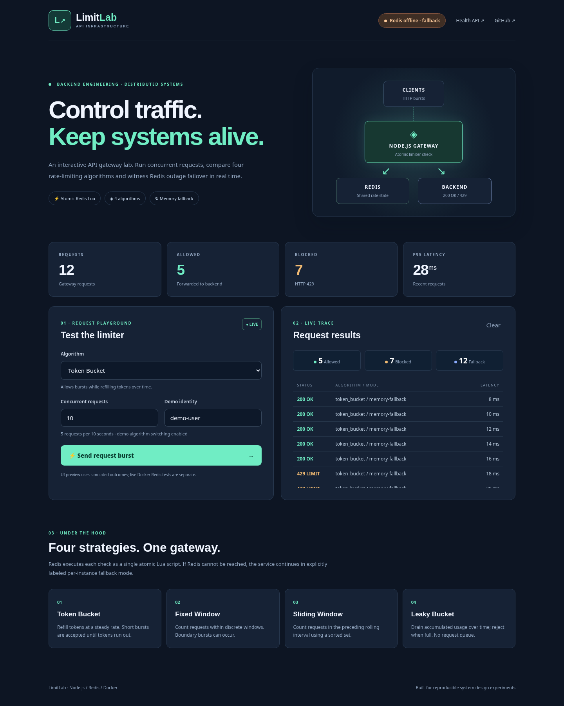
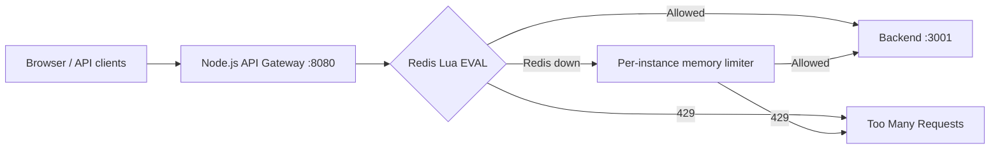

# Distributed Rate Limiter · LimitLab

[](https://nodejs.org/api/test.html)    

A **fault-tolerant Node.js API gateway** that limits concurrent traffic using **atomic Redis Lua scripts**, compares four algorithms, and degrades to a clearly identified **in-memory fallback** when Redis is unavailable. Designed as a reproducible backend engineering portfolio project with a live dashboard, automated tests, Docker setup, and failure-injection experiments.



*Dashboard illustration with simulated response counters. Live Docker/Redis performance is verified separately using the commands below.*

> **Scope:** This is a functional local lab / portfolio MVP, not a production-ready ingress or security product. The in-memory fallback preserves gateway availability, **not** globally consistent quotas during Redis outages. No fabricated benchmark results are included.

## Features

- Atomic Redis `EVAL` for **Token Bucket**, **Fixed Window**, **Sliding Window**, and **Leaky Bucket meter**
- Shared limit state across gateway instances, synchronized by Redis `TIME`
- Node.js gateway proxies admitted requests to a sample backend and returns `429 Too Many Requests` for excess traffic
- Per-request `RateLimit-*`, `Retry-After` and `X-RateLimit-Mode` response headers
- Automatic Redis outage fallback and automatic recovery; mode is visible in headers and dashboard
- Concurrent-request tests, scripted fault-injection walkthrough, benchmark CLI, and multi-gateway verification
- Responsive monitoring dashboard with live metrics and burst generator
- **Zero npm dependencies:** built with native Node.js HTTP, TCP, crypto, and test runner
- Docker Compose starts three services: **gateway + backend + Redis**

## 1. Run on Windows (recommended: Docker Desktop)

You need **Node.js 20+** and **Docker Desktop** (with its engine running). No `npm install` is necessary.

```powershell
# In VS Code Terminal → New Terminal, inside the extracted project folder:
node --version
docker --version
docker compose up -d --build
```

Open **http://127.0.0.1:8080** in Chrome. The dashboard lets you send a burst of 10 requests while the default capacity is 5 per 10 seconds. The first 5 should generally return `200`; excess requests return `429` (when the bucket hasn't refilled). Select each algorithm in the dropdown to compare behavior; this override is enabled **only in the local Docker demo configuration**.

Run a quick test:

```powershell
npm test
node scripts/verify.js
```

Stop the lab when you're finished:

```powershell
docker compose down
```

This does **not** delete saved Redis volume data. To erase Redis data, use `docker compose down -v` (optional and destructive).

## 2. Redis failure injection and recovery

Open a new VS Code terminal in the project folder; leave the gateway running through Docker.

```powershell
# Break Redis on purpose
docker compose stop redis
node scripts/verify.js
```

Requests should still return `200` and `429` but report `memory-fallback` mode instead of `redis`.

```powershell
# Bring Redis back
docker compose start redis
node scripts/verify.js
```

The mode returns to `redis` when the connection is restored. If this doesn't happen, inspect `docker compose logs gateway redis`. For a two-gateway shared-quota test, see [verification guide](docs/VERIFICATION.md).

## 3. Compare the four algorithms

| Algorithm | How it works | Characteristic |
| --- | --- | --- |
| Token Bucket | Tokens refill continuously; each accepted call consumes one | Allows short bursts |
| Fixed Window | Count requests inside a non-overlapping interval | Can burst across a boundary |
| Sliding Window | Store timestamps in Redis sorted set; count trailing interval | Precise rolling limits, more storage |
| Leaky Bucket | Accumulated use drains steadily; reject when full | *Meter-style*, no request queue |

The default limit is **5 requests / 10 seconds**, configurable through environment variables or by copying `.env.example` to `.env` (loaded locally and ignored by Git). The gateway does not trust a caller to choose an algorithm outside demo mode.

To collect real performance numbers from your laptop (with Docker running):

```powershell
node scripts/benchmark.js 30 20
```

This performs **30 HTTP calls per algorithm** at concurrency **20**, prints allowed, blocked, errors, fallback, measured throughput, p50 and p95 latency, and writes `results/benchmark.json` (ignored by Git). Results are intentionally not hardcoded.

## 4. Run without Docker (offline fallback demo)

In two terminals:

```powershell
# Terminal 1
npm run backend
```

```powershell
# Terminal 2
npm start
```

Open http://127.0.0.1:8080. Because Redis isn't running, requests are handled through memory fallback and the dashboard marks the outage explicitly. For fully distributed behavior, start Docker Compose instead.

## Architecture



The scripts use the Redis server clock and execute atomically. Every admission request uses a hashed client identity and a key specific to its algorithm. By default this identity is the **direct remote IP**. For repeatable *local* experiments, Docker sets `ALLOW_DEMO_ALGORITHM_SWITCH=true`, which allows the dashboard to supply a demo client ID and algorithm. **Never enable that in an internet-exposed deployment.**

Learn more in [architecture notes](docs/ARCHITECTURE.md) and [verification steps](docs/VERIFICATION.md).

## API

| Method / endpoint | Purpose |
| --- | --- |
| `GET /` | Interactive dashboard |
| `GET /api/work` | Rate-limited request forwarded to sample backend |
| `GET /api/health` | Gateway health and last Redis/fallback mode |
| `GET /api/config` | Effective algorithm, capacity, window, demo-switch setting |
| `GET /api/metrics` | Counts and recent p50/p95/p99 gateway latency |

Example response headers:

```http
HTTP/1.1 429 Too Many Requests
RateLimit-Limit: 5
RateLimit-Remaining: 0
RateLimit-Reset: 2
Retry-After: 2
X-RateLimit-Algorithm: token_bucket
X-RateLimit-Mode: redis
```

## Project structure

```text
distributed-rate-limiter/
├── src/
│   ├── algorithms/       # Four deterministic memory fallback rules + Redis Lua scripts
│   ├── redis/            # Native RESP2 client and EVAL store
│   ├── config.js
│   ├── limiter.js        # Fault-tolerant Redis → memory decision layer
│   ├── gateway.js        # HTTP routes, headers, proxy, and metrics
│   └── server.js
├── backend/server.js     # Example upstream backend
├── public/               # Interactive dashboard
├── scripts/              # Live verification and benchmark CLI
├── tests/                # Native Node.js unit and HTTP tests
├── docs/                 # Architecture, screenshot, verification checklist
├── .github/workflows/    # Automated Node.js tests in GitHub Actions
├── compose.yaml          # Gateway, backend, Redis
├── Dockerfile
├── package.json
├── .env.example
└── README.md
```

## Validation and limits

Unit/integration tests are run with `npm test` (no external npm packages); HTTP concurrency and outage fallback are exercised with test stores. **The Lua scripts and Docker integration have not been exercised in the build environment**, so run the Docker verification steps above before claiming live Redis performance or global multi-instance enforcement. We do not claim zero downtime, perfect consistency, or measured speedups.

Known limitations: `redis://` only (no TLS/password support); default IP quotas share one identity for clients behind a reverse proxy; no authenticated API-key identities; only one GET endpoint proxied; no queue in the leaky-bucket meter; fallback buckets are local to each instance and may allow over-limit bursts during failover or recovery; demonstration endpoint selection can be bypassed when demo switching is enabled. Redis errors from Lua programs are not silently treated as outages.

## Resume summary (after you verify with Docker)

> Built a Node.js API gateway with four Redis-backed rate-limiting algorithms implemented as atomic Lua scripts; added a bounded per-instance memory fallback for Redis outages, tested HTTP 429 behavior under concurrent load, and containerized gateway, backend and Redis using Docker Compose.

**License:** MIT. See [LICENSE](LICENSE).
