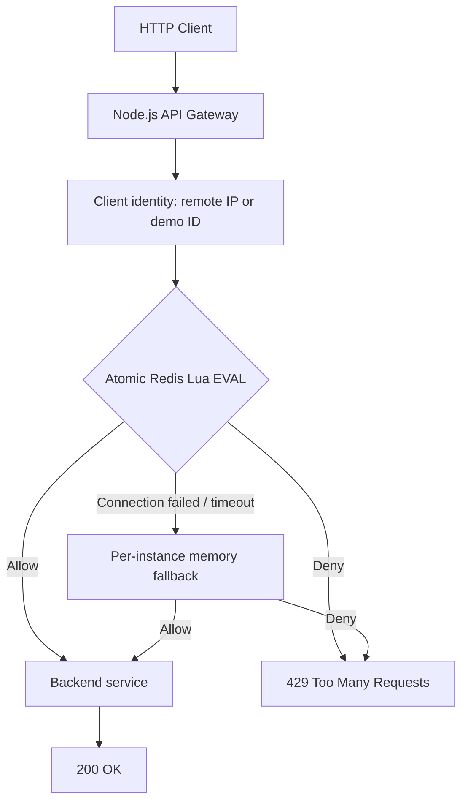

# Architecture and algorithms

## Request lifecycle

All four Redis implementations use the `TIME` command inside a single `EVAL` invocation. This avoids relying on slightly different clocks on different gateway hosts. The client transmits scripts using RESP2 over TCP and pipelines responses in FIFO order. The RESP codec is intentionally small and dependency-free, and the gateway supports only `redis://` (no TLS/auth). The demo is designed for a private Docker network, not public deployment.

## Algorithms compared

| Algorithm | Redis representation | Admission rule | Tradeoff |
| --- | --- | --- | --- |
| Token Bucket | Hash: `tokens`, `ts` | Available tokens ≥ 1 | Bursts with smooth refill, fractional state |
| Fixed Window | Hash: `slot`, `count` | Current interval count below capacity | Simple; boundary bursts possible |
| Sliding Window | Sorted set: request UUID → epoch ms | Count of timestamps in trailing window below capacity | Precise rolling quotas, O(capacity) memory per hot identity |
| Leaky Bucket meter | Hash: `water`, `ts` | Water level + 1 ≤ capacity | Smooth discharge, *rejects* rather than queues |

**Token bucket rate:** `capacity / windowMs` tokens per millisecond. The default 5 requests per 10 seconds permits 5 immediate calls, then approximately one additional call every 2 seconds.

**Keying:** `rl:v1:<algorithm>:<sha256(identity)>`, with identity the direct socket IP by default. `X-Demo-Client-ID` works only when `ALLOW_DEMO_ALGORITHM_SWITCH=true` and is not an authentication mechanism.

## Fallback and recovery

- Redis transport errors and timeouts trigger **local in-memory** admission checks. The gateway still serves requests, reports `X-RateLimit-Mode: memory-fallback`, and sets an HTTP `Warning` header. Quotas are no longer global across gateway instances.
- Redis Lua command errors are treated as application errors (500), not as outages to conceal.
- Every new request attempts Redis again. When Redis returns, new decisions use the shared Redis store. The local and Redis state are **not synchronized**, so a transition can temporarily exceed intended limits.
- Sliding-window timestamp UUIDs avoid collapsing requests that share a millisecond.
- State expiration and a maximum in-memory identity count bound fallback memory use.

## Key limitations and production hardening

This is a **portfolio and local-learning prototype**, not a drop-in enterprise service. Hardening would include: authentication and verified API-key identities; TLS and Redis ACL/password support; per-route policies; Redis Cluster key design; circuit breakers and jittered reconnects; rate-limit policy configuration behind authenticated admin APIs; observability exporters; tests against a real Redis instance in CI; client-facing fairness during fallback; static asset hosting; and upstream request body streaming. Only a single GET `/api/work` route is proxied by design. The included backend simulates useful work without dependencies.

### Sources

- [Redis EVAL / atomic execution](https://redis.io/docs/latest/commands/eval/)
- [Redis scripting introduction](https://redis.io/docs/latest/develop/interact/programmability/eval-intro/)
- [Redis TIME](https://redis.io/docs/latest/commands/time/)
